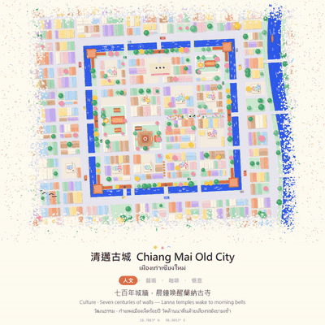
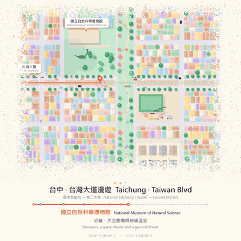
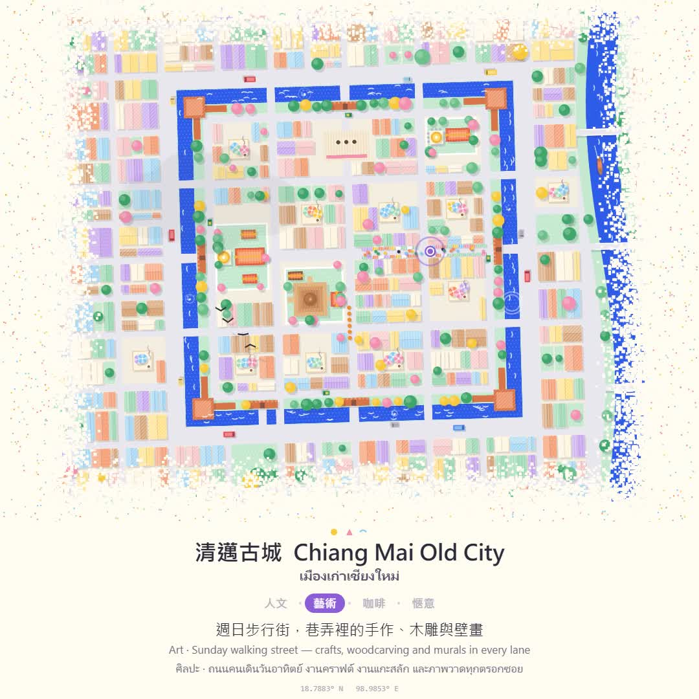
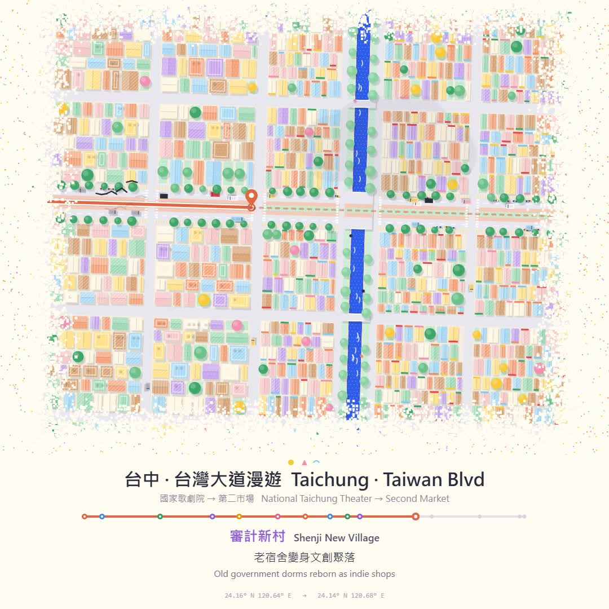

# 🗺️ Cute Miniature Map · 可愛微縮地圖動畫 Skill

> 一句話，讓 Claude 用純程式碼幫你做出「桌上小模型」般的城市地圖動畫。
> One prompt → a cozy, hand-made-looking miniature map animation, drawn entirely in code.

<p align="center">
  
  
</p>

**完全免費、開源（MIT）。如果它幫到你，請按右上角的 ⭐ Star 支持一下，這是我繼續分享的最大動力！**

---

## ✨ 做得出什麼

| 定點微縮（city） | 散步路線（route） |
|---|---|
|  |  |
| 清邁古城：護城河、城門、寺院、咖啡館、雙條車、托缽僧。中英泰三語文案「人文／藝術／咖啡／愜意」，15 秒 | 台中：國家歌劇院 → 台灣大道 → 第二市場，14 個景點依序彈出卡片，路線一路畫過去，30 秒 |

畫面特色：
- 🎨 **輕鬆可愛的配色**：紙張底色、馬卡龍平塗色塊、絹印般的網點／條紋紋理
- 🏠 **微縮模型感**：影子長度跟樓高成正比、圓圓會「呼吸」的樹、萌化的地標
- 🛵 **一直在動的小東西**：機車群、公車、捷運、划船、咖啡熱氣、飛鳥與牠們的影子、雲影
- 🌫️ **紙張顆粒溶解邊緣**：地圖像是印在紙上，四周慢慢散進紙色
- 🔤 **多語字卡**：繁中／English／ไทย，主題文案淡入切換
- 🔊 **程式合成的音效**：寺鐘、入水聲、景點出現的木琴「叮」，也能疊你自己的背景音樂

全部是 HTML Canvas＋Node＋ffmpeg＋Python，**不需要任何素材圖，也不需要 AI 生圖**。

## 📦 安裝

### Claude Code
```bash
git clone https://github.com/lovemage/cute-miniature-map ~/.claude/skills/cute-miniature-map
```
Windows（PowerShell）：
```powershell
git clone https://github.com/lovemage/cute-miniature-map "$env:USERPROFILE\.claude\skills\cute-miniature-map"
```

### Claude.ai（網頁版／桌面版）
下載本 repo 的 ZIP → 到 **Settings → Capabilities → Skills** 上傳。

### 需要的工具
- Node.js 18+、`npm i playwright`
- ffmpeg
- Python 3＋`numpy`、`scipy`
- Windows 會直接用系統的 Edge 截圖；macOS／Linux 第一次請跑 `npx playwright install chromium`

## 🚀 使用方式

在 Claude Code 裡直接說：

```
/cute-miniature-map 製作清邁古城動畫，文案：人文／藝術／咖啡／愜意，中英泰，15 秒
```
```
/cute-miniature-map 台中路線：歌劇院一路到台灣大道第二市場，30 秒，景點多一點
```
```
/cute-miniature-map 幫我做京都哲學之道的散步路線，櫻花季配色，中日英
```

Claude 會：選模式 → 改範本的地理資料與文案 → 先出幾張靜態幀給你看 → 渲染整支 MP4 → 合成音效（或混你的背景音樂）。

## 📁 內容

```
SKILL.md              # 給 Claude 看的完整做法與美術規則
templates/city.html   # 定點微縮範本（清邁古城）
templates/route.html  # 路線動畫範本（台中台灣大道）
scripts/render.js     # Playwright 逐幀截圖 → ffmpeg
scripts/audio_city.py # 定點模式音效
scripts/audio_route.py# 路線模式音效（讀 meta.json 對齊景點）
```

範本的 `scene.html` 直接用瀏覽器打開就是會動的網頁動畫。

## ⚠️ 小提醒
範例地圖是**示意風格**，不是精確比例的地圖；做你自己的城市時，記得確認景點位置與名稱。

---

## English

**Cute Miniature Map** is a Claude skill that turns a place, or a walk from A to B, into a cozy top-down miniature-model animation: paper background, flat pastel blocks with print textures, height-based shadows, breathing round trees, lots of tiny moving things (scooters, buses, boats, coffee steam, birds and their shadows), a grainy paper-dissolve edge and clean multilingual captions. It's all code (Canvas + Playwright + ffmpeg + numpy), no image assets or AI image generation.

Install for Claude Code: `git clone https://github.com/lovemage/cute-miniature-map ~/.claude/skills/cute-miniature-map`, then ask e.g. *"/cute-miniature-map a walking route from the Louvre to Notre-Dame, 30s, EN + FR captions"*.

**Free and open source (MIT). If you like it, a ⭐ star means a lot!**

---

Made with ☕ by **Ivan · OceanAds** — [oceanads.org](https://oceanads.org) · Threads／IG [@oceanads_dev](https://www.instagram.com/oceanads_dev/)
